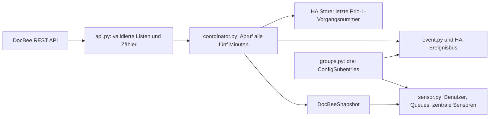

# Technische Architektur

Stand: 17.11.2026; analysierte Implementierung: Version 0.3.1, Commit `247eb17`.
Diese Dokumentationsänderung verändert die Laufzeitarchitektur nicht.

## Systemgrenzen und Technologien

Your Docbee Connect ist eine Python-Custom-Integration für Home Assistant,
installierbar über HACS oder durch Kopieren von `custom_components/docbee`.
Domain `docbee`, Integrationstyp `hub`, IoT-Klasse `cloud_polling`.
Python 3.13 ist erforderlich; getestet wird mit HA Core 2025.6.3. aiohttp,
yarl und voluptuous werden von HA bereitgestellt; das Manifest hat keine
zusätzlichen Runtime-Requirements. Es gibt keinen separaten App-Server,
keine eigene Datenbank und keinen Node-/Frontend-Build.

## Komponenten

| Datei | Verantwortung |
| --- | --- |
| `__init__.py` | Setup, erster Abruf, Store laden, Gruppen vorbereiten, Sensor-/Event-Plattform laden, Unload/Store-Cleanup |
| `config_flow.py` | URL und Token im UI prüfen, doppelte Instanzen verhindern, Token erneuern |
| `api.py` | HTTPS/Bearer-GET, keine Weiterleitungen, Timeout, Fehlerklassen, vollständige Pagination, Datenvalidierung und Aggregation |
| `models.py` | `DocBeeUser`, `DocBeeQueue`, `DocBeeSnapshot` als Dataclasses |
| `coordinator.py` | Regelmäßige Updates, HA-Zeitzone/Tageszähler, Prio-1-Vergleich und Ereignisse, lokale Speicherung |
| `devices.py` | Stabile Gerätekennungen und Metadaten; Anzeigename aus `name`, Ersatz `username` |
| `groups.py` | Native Untereinträge `central`, `user`, `queue`; Migration bestehender Registry-Zuordnungen |
| `sensor.py` | Text-/Enum-Sensoren und numerische Messwerte, dynamische Gerätediscovery |
| `event.py` | EventEntity am zentralen Gerät, Ereignistyp `priority_one_ticket` |
| `const.py` | Domain, feste Namen und instanzbezogenes Dispatcher-Signal |
| `manifest.json`, `hacs.json` | HA-/HACS-Metadaten; Version und getestete HA-Untergrenze |
| `strings.json`, `translations/` | Englische Basis sowie deutsche/englische UI-Texte |

## Einrichtung und Aktualisierung

Ein ConfigEntry speichert normalisierte HTTPS-URL und Access Token. Der Token
wird ohne Präfix `Bearer ` eingegeben; der Client erzeugt den Header. Die
Einrichtung prüft `async_get_snapshot()`. Beim tatsächlichen Setup/Update ergänzt
der Coordinator außerdem die drei Tageszähler. Ein API-Fehler bei diesen späteren
Abfragen kann daher trotz erfolgreich abgeschlossenem Eingabedialog auftreten.

Der Coordinator verwendet die HA-aiohttp-Session, `update_interval=5 Minuten`
und `always_update=False`. Der Datenstand wird erst nach erfolgreichem Abruf
übernommen. Das ist eine lokale vollständige Übernahme, **keine serverseitige
Transaktion** über alle DocBee-Anfragen hinweg. Fehlgeschlagene Updates machen
Sensoren nicht verfügbar; HTTP 401/403 löst die erneute Authentifizierung aus.

## API-Verträge

Quellen:
- [Übersicht](https://documentation.docbee.com/rest_api/)
- [Detailansicht](https://my.docbee.com/restApi/v1/documentation#overview)
- [OpenAPI](https://my.docbee.com/restApi/v1/openapi.json), bisher geprüfte Version 2026.2.0

`my.docbee.com` ist die bekannte Dokumentations-/Instanzadresse, aber keine im
Code festgeschriebene Zielinstanz. Verwendet wird die konfigurierte URL.

| Ressource/Filter | Verwendungszweck |
| --- | --- |
| `user`, Felder `id,username,name,enabled,permissionGroup.id,permissionGroup.name` | Benutzer, Anzeigename, Aktiv-Status und expandierter Rollenname |
| `queue`, `id,name` | Queue-Geräte |
| `priority`, `id,priority` | Prioritäts-IDs mit numerischem Wert 100 bestimmen |
| `ticket`, `id,owner,priority`, `notClosed=true` | Zähler nach Verantwortlichem/Queue und zentrale offene/priorisierte Vorgänge |
| `ticket`, `id,ticketNumber`, `priorityIds=…` | Prio-1-Ereignisvergleich einschließlich geschlossener Vorgänge |
| `ticket`, `limit=1`, `startDate`, `endDate`, `ticketScope` | Tageszähler aus `totalCount`: `TICKET_MODIFIED`, `TICKET_CREATED`, `TICKET_CLOSED` |

Listen liegen im Objekt unter dem Ressourcennamen (`user`, **nicht** `data`),
mit `totalCount`, `offset` und `limit`. Standardabfragen verwenden maximal 50
Einträge, Offset und `sortings=id asc`. Wiederholte IDs, wechselnde Gesamtzahlen,
vorzeitige Leerlisten oder über 1.000 Seiten werden abgewiesen. Tageszähler
verwenden direkt `totalCount`, nicht die Länge der Seite mit `limit=1`.

Prioritätswerte wie `100`, `100.0`, `"100"` sind akzeptiert, ungültige Werte
werden nicht zu null umgedeutet. Bei ungültigen/unbekannten Prioritätsdaten
bleibt der Prio-1-Zähler nicht verfügbar und der Ereignisvergleich wird ausgesetzt.
Andere vollständige Abruf-/Schemafehler können weiterhin das gesamte Update stoppen.

## Geräte, Entitäten und Identitäten

Drei feste ConfigSubentries pro Verbindung: **Zentrale Konfiguration**, **Benutzer**,
**Queues**. Geräte-IDs verwenden `(docbee, <entry_id>:<typ>:<id>)`, zentral
`(docbee, <entry_id>:central)`. Entity-Unique-IDs ergänzen den Sensorschlüssel.
Das erhält Benutzername-Entitäten aus früheren Versionen. Die sichtbaren
`sensor.*`-/`event.*`-IDs legt HA fest; nicht fest im Code oder Dokument voraussetzen.

Registry-Migration: neue Subentry-Gerätezuordnung hinzufügen, Entity-Zuordnung
aktualisieren, dann Root-Verknüpfung entfernen. Eine frühere Testvariante entfernte
Root zuerst und löschte dadurch Entities; der Migrationstest schützt diese Reihenfolge.

Benutzer bekommen Benutzername, Rolle, Aktiv (`yes`/`no`, lokalisiert Ja/Nein),
zugewiesene nicht geschlossene Vorgänge. Queues bekommen aktuelle nicht geschlossene
Tickets. Zentrale Sensoren und ihre exakten Bedeutungen stehen im Handbuch.
Entfernte Benutzer/Queues bleiben registriert und werden nicht verfügbar.

## Ereignisse und persistenter Zustand

Der Vergleich erfolgt über Ticket-IDs mit Prioritätswert 100. Neu in dieser Menge
bedeutet Neuanlage oder beobachtete Hochstufung. Statusänderung allein ist kein
Prio-Wechsel. Alle Treffer erzeugen `docbee_priority_one_ticket` mit
`config_entry_id`, `device_id`, `ticket_id`, `ticket_number` sowie das zugehörige
EventEntity-Ereignis. Die Textentität hält die zuletzt verarbeitete Nummer.

`Store(version=1, key=docbee.<entry_id>.priority_events)` speichert ausschließlich
`last_ticket_number`. Der Vergleichsbestand wird **nicht** dauerhaft gespeichert:
Start/Reload setzt eine neue Baseline ohne historische Ereignisse. Abruffehler
leeren den letzten gültigen Bestand nicht. Dispatcher-Signale sind pro Verbindung
isoliert; Registrierungen werden beim Unload entfernt. Diese HA-Laufzeitdaten
gehören nicht zur Synchronisierung der Entwicklungsrechner.

## Tests und Grenzen

`tests/test_api.py`: simulierte HTTP-Antworten, Pagination, Datenformate, Filter.
`tests/test_integration.py`: echter HA-Core mit simuliertem DocBee-Client,
Einrichtungsdialoge, Registry, Updates, Migration, Ereignisse/Reload und Zeitzonen.
`tests/test_devices.py`: Identitätsinvarianten. Kein Test benötigt echte Tokens.
Keine CI-Konfiguration, kein Frontend-End-to-End-Test und keine produktive
DocBee-Testinstanz sind derzeit im Repository eingerichtet.
